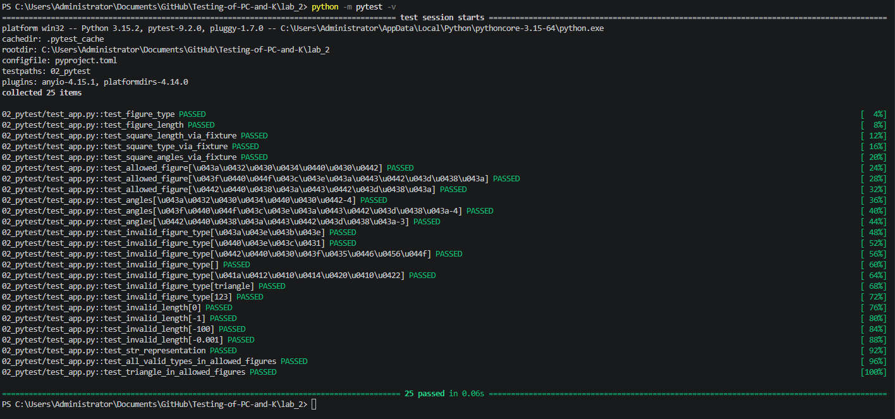
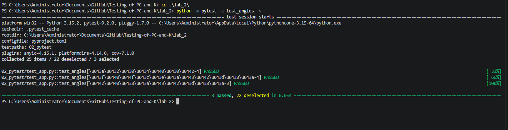
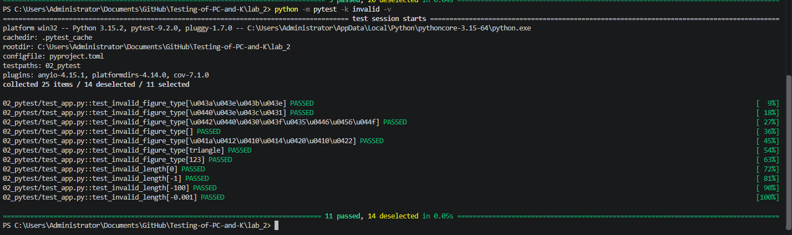
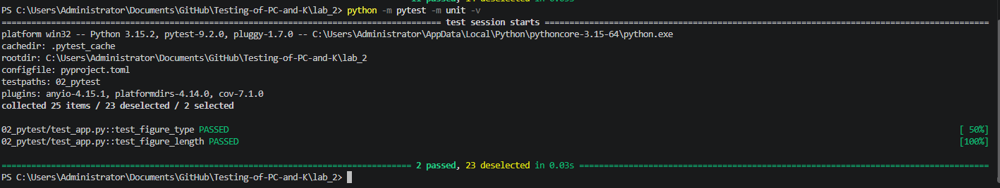
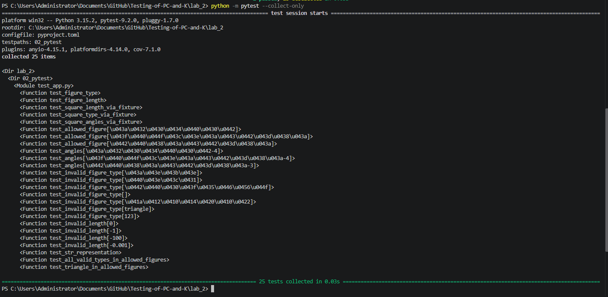
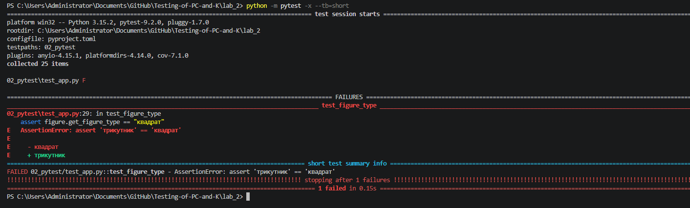
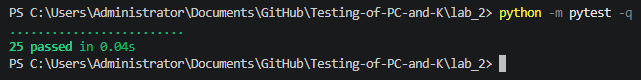
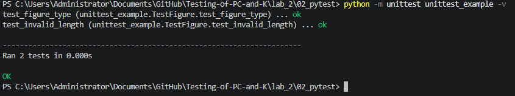
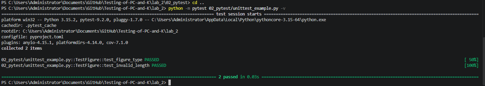

# Звіт до роботи
## Тема: Тестування з бібліотекою pytest
### Мета роботи: Навчитися писати тести за допомогою бібліотеки pytest, використовувати `assert`, `pytest.raises`, параметризацію (`parametrize`), fixtures (у т.ч. зі `scope="module"`) та маркери, а також порівняти pytest із `unittest`.

---
### Виконання роботи

* **Завдання 1 — Встановлення pytest і запуск тестів**
    1. Встановили `pytest` (через `pip`)
    2. Створили клас `Figure` (`app.py`) і тести для нього (`test_app.py`)
    3. Запустили всі тести з детальним виводом
    4. Результат: 25 тестів, усі пройшли

```text
pip install pytest
python -m pytest -v
```



* **Завдання 2 — Базові тести з `assert`**
    1. На відміну від `unittest`, у pytest достатньо звичайного `assert`
    2. Перевірили збереження типу та довжини фігури, кількість кутів і рядкове представлення

```python
def test_figure_type():
    figure = Figure("трикутник", 4)
    assert figure.get_figure_type == "трикутник"

def test_figure_length():
    figure = Figure("прямокутник", 7.5)
    assert figure.get_figure_length == 7.5

def test_str_representation():
    figure = Figure("трикутник", 3)
    assert "трикутник" in str(figure)
    assert "3" in str(figure)
```

* **Завдання 3 — Параметризація (`@pytest.mark.parametrize`)**
    1. Один тест автоматично запускається для кожного набору даних
    2. Параметризували перевірку кількості кутів: квадрат — 4, прямокутник — 4, трикутник — 3
    3. У виводі кожен набір є окремим тестом із власним ідентифікатором

```python
@pytest.mark.parametrize("figure_type, expected_angles", [
    ("квадрат", 4),
    ("прямокутник", 4),
    ("трикутник", 3),
])
def test_angles(figure_type, expected_angles):
    figure = Figure(figure_type, 5)
    assert figure.get_angles == expected_angles
```

```text
python -m pytest -k test_angles -v
```



* **Завдання 4 — Fixtures**
    1. Створили fixture `square`, що готує спільний об'єкт для кількох тестів (область видимості за замовчуванням — функція: створюється заново для кожного тесту)
    2. Створили fixture `allowed_figures` зі `scope="module"`: створюється один раз для всього модуля
    3. Прапор `--setup-show` показує, коли fixture створюється (`SETUP`) і знищується (`TEARDOWN`)

```python
@pytest.fixture
def square():
    return Figure("квадрат", 10)

@pytest.fixture(scope="module")
def allowed_figures():
    return Figure.VALID_TYPES

def test_square_length_via_fixture(square):
    assert square.get_figure_length == 10

def test_all_valid_types_in_allowed_figures(allowed_figures):
    assert len(allowed_figures) == 3
```

```text
python -m pytest -k "via_fixture or allowed_figures" --setup-show -v
```


Різниця областей видимості: fixture `square` (F, function) створюється й знищується для кожного з трьох тестів, а `allowed_figures` (M, module) створюється один раз і використовується обома тестами.

* **Завдання 5 — Тести на помилки (`pytest.raises`)**
    1. Перевірили, що неправильний тип фігури (`коло`, `ромб`, порожній рядок, `КВАДРАТ`, `triangle`, число `123`) призводить до винятку
    2. Перевірили, що довжина ≤ 0 (`0`, `-1`, `-100`, `-0.001`) призводить до `ValueError`
    3. Обидва тести параметризовані, тому кожне значення перевіряється окремо

```python
@pytest.mark.parametrize("invalid_type", ["коло", "ромб", "трапеція", "", "КВАДРАТ", "triangle", 123])
def test_invalid_figure_type(invalid_type):
    with pytest.raises((ValueError, TypeError)):
        Figure(invalid_type, 5)

@pytest.mark.parametrize("invalid_length", [0, -1, -100, -0.001])
def test_invalid_length(invalid_length):
    with pytest.raises(ValueError):
        Figure("квадрат", invalid_length)
```

```text
python -m pytest -k invalid -v
```



* **Завдання 6 — Маркери**
    1. Позначили два тести маркером `@pytest.mark.unit`
    2. Маркери зареєстровані у `pyproject.toml`, тому pytest не видає попереджень
    3. Запустили лише помічені тести — решту pytest відфільтрував (`deselected`)
    4. Показали всі знайдені тести без запуску (`--collect-only`)

```python
@pytest.mark.unit
def test_figure_type():
    figure = Figure("трикутник", 4)
    assert figure.get_figure_type == "трикутник"
```

```text
python -m pytest -m unit -v
python -m pytest --collect-only
```

Запуск лише тестів із маркером `unit`:



Список знайдених тестів без запуску:



* **Завдання 7 — Навмисно зламаний тест та `pytest -x --tb=short`**
    1. У `test_figure_type` навмисно змінили очікуване значення на неправильне
    2. Запустили pytest із прапорами `-x` (зупинитися після першої помилки) і `--tb=short` (короткий traceback)
    3. pytest показав, який саме `assert` не виконався і з якими значеннями
    4. Після перевірки повернули правильне значення — усі тести знову проходять

```python
def test_figure_type():
    figure = Figure("трикутник", 4)
    assert figure.get_figure_type == "квадрат"   # навмисна помилка
```

```text
python -m pytest -x --tb=short
```



Після виправлення:

```text
python -m pytest -q
```



* **Завдання 8 — Різниця між `unittest.TestCase` та функцією pytest**
    1. Написали ті самі перевірки і на `unittest`, і на pytest
    2. Запустили unittest-версію (`unittest_example.py`) окремо і через pytest (pytest уміє запускати й unittest-тести)

| Критерій | `unittest.TestCase` | pytest-функція |
|---|---|---|
| Структура | Клас, що успадковує `TestCase` | Звичайна функція з префіксом `test_` |
| Перевірки | `self.assertEqual(a, b)`, `self.assertRaises(...)` | Звичайний `assert a == b`, `pytest.raises(...)` |
| Запуск | `python -m unittest` | `pytest` |
| Fixtures | `setUp` / `tearDown` методи класу | Декоратор `@pytest.fixture`, будь-яка область видимості |
| Параметризація | Ручний цикл або `subTest` | Вбудований `@pytest.mark.parametrize` |
| Повідомлення про помилку | Стандартне, менш детальне | Детальний diff при провалі |

unittest:
```python
class TestFigure(unittest.TestCase):
    def test_figure_type(self):
        figure = Figure("трикутник", 4)
        self.assertEqual(figure.get_figure_type, "трикутник")

    def test_invalid_length(self):
        with self.assertRaises(ValueError):
            Figure("квадрат", 0)
```

pytest:
```python
def test_figure_type():
    figure = Figure("трикутник", 4)
    assert figure.get_figure_type == "трикутник"

def test_invalid_length():
    with pytest.raises(ValueError):
        Figure("квадрат", 0)
```

```text
cd 02_pytest
python -m unittest unittest_example -v
cd ..
python -m pytest 02_pytest/unittest_example.py -v
```

Запуск через unittest:



Той самий файл через pytest:



* **Що не комітиться** (файл `.gitignore`):
```text
__pycache__/
*.pyc
.venv/
.pytest_cache/
```

* **Команди запуску:**
```text
cd lab_2
python -m pytest -v
python -m pytest -m unit -v
python -m pytest --collect-only
python -m pytest -x --tb=short
```

* **Результат виконання тестів:**


---
### Висновок:

- В роботі реалізовано юніт-тестування на Python за допомогою бібліотеки `pytest`
- Мету роботи досягнуто — написано 25 тестів для класу `Figure`, усі пройшли (`25 passed in 0.06s`)
- Отримано знання про `assert`, `pytest.raises`, `@pytest.mark.parametrize`, `@pytest.fixture` (у т.ч. `scope="module"`) та маркери
- Вивчено корисні прапори: `-v`, `-k`, `-m`, `-x`, `--tb=short`, `--collect-only`, `--setup-show`
- Вивчено різницю між `unittest.TestCase` і pytest-функціями: pytest простіший і лаконічніший, а параметризація й fixtures вбудовані
- Складність виникла з налаштуванням середовища: `pytest` не розпізнавався без `python -m pytest`
- Формат здачі через GitHub зручний і наочний
