# Звіт до роботи
## Тема: Покриття коду
### Мета роботи: Навчитися вимірювати покриття коду тестами за допомогою coverage.py та pytest-cov, розрізняти покриття рядків і розгалужень, налаштовувати виключення (`pragma: no cover`), формувати HTML/XML-звіти та контролювати мінімальний поріг покриття.

---
### Виконання роботи

* **Завдання 1 — Встановлення та запуск тестів**
    1. Встановили `coverage`, `pytest` та `pytest-cov`
    2. Запустили всі тести папки `03_coverage`
    3. Результат: 51 тест пройшов, 3 підтести пройшли

```text
python -m pip install coverage pytest pytest-cov
cd lab_3\03_coverage
python -m pytest -v
```

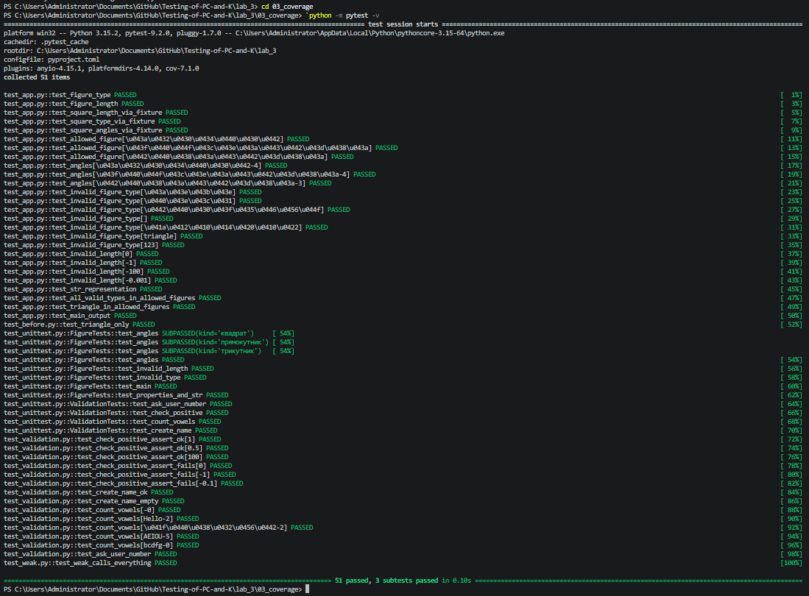

* **Завдання 2 — Окремі запуски unittest і pytest**
    1. Перед кожним вимірюванням виконали `coverage erase`, щоб результати двох наборів не змішувалися в одному файлі `.coverage`
    2. Окремо виміряли покриття набору `unittest` (9 тестів) та набору `pytest` (40 тестів)
    3. Обидва набори дали однаковий результат: 100% за рядками й гілками

```text
python -m coverage erase
python -m coverage run -m unittest test_unittest
python -m coverage report -m

python -m coverage erase
python -m coverage run -m pytest test_app.py test_validation.py
python -m coverage report -m
```

| Файл | Stmts | Miss | Branch | BrPart | Cover |
|---|---|---|---|---|---|
| app.py | 27 | 0 | 8 | 0 | 100% |
| validation.py | 13 | 0 | 2 | 0 | 100% |
| TOTAL | 40 | 0 | 10 | 0 | 100% |

unittest:

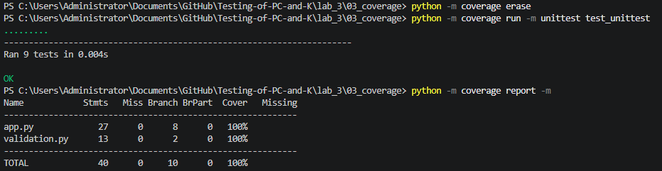

pytest:

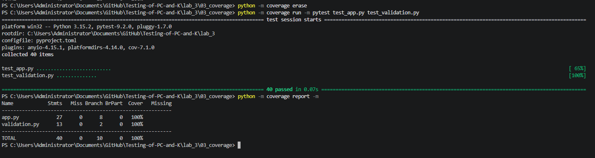

* **Завдання 3 — Розгалуження: покриття до і після додавання тестів**
    1. У `test_before.py` залишили лише тест для трикутника — це стан «до»
    2. Виміряли покриття, проаналізували стовпець `Missing`
    3. Додали тести для квадрата, прямокутника, неправильного типу й довжини, `__str__`, `main()` та функцій `validation.py`, після чого повторили вимір

```text
python -m coverage erase
python -m coverage run -m pytest test_before.py
python -m coverage report -m
```

До змін:

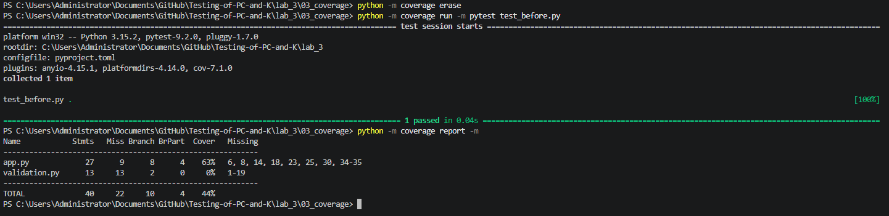

| Файл | Stmts | Miss | Branch | BrPart | Cover | Missing |
|---|---|---|---|---|---|---|
| app.py | 27 | 9 | 8 | 4 | 63% | 6, 8, 14, 18, 23, 25, 30, 34-35 |
| validation.py | 13 | 13 | 2 | 0 | 0% | 1-19 |
| TOTAL | 40 | 22 | 10 | 4 | 44% | |

Які рядки були пропущені до змін:
- рядки 6 і 8 — `raise ValueError` для неправильної довжини й типу: жоден тест не передавав такі значення
- рядки 14 і 18 — геттери `get_figure_type`, `get_figure_length`: не викликались
- рядки 23 і 25 — `return 4` для квадрата й прямокутника: перевірявся лише трикутник (гілка `else`)
- рядок 30 — `__str__`, рядки 34–35 — тіло `main()`: не викликались
- `validation.py` (1–19) — тест не імпортував файл, а `source = .` змушує coverage враховувати його як непокритий

Після змін:

```text
python -m coverage erase
python -m coverage run -m pytest test_app.py test_validation.py
python -m coverage report -m
```

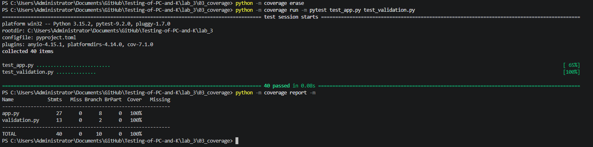

| Етап | Stmts | Miss | Branch | BrPart | Cover |
|---|---|---|---|---|---|
| До | 40 | 22 | 10 | 4 | 44% |
| Після | 40 | 0 | 10 | 0 | 100% |

Різниця між покриттям рядків і розгалужень:
- Line coverage показує, чи виконувався рядок хоча б раз
- Branch coverage показує, чи пройшли тести кожен напрямок умови (`True` і `False`)
- До змін рядки `if length <= 0` та `if figure_type not in ...` виконувались, але ніколи не були істинними — тому `BrPart = 4`

* **Завдання 4 — Запуск через pytest-cov**
    1. Виміряли покриття одним запуском через плагін
    2. Параметр `--cov-branch` вмикає покриття розгалужень, `term-missing` показує пропущені рядки

```text
python -m pytest --cov=app --cov=validation --cov-branch --cov-report=term-missing -v
```

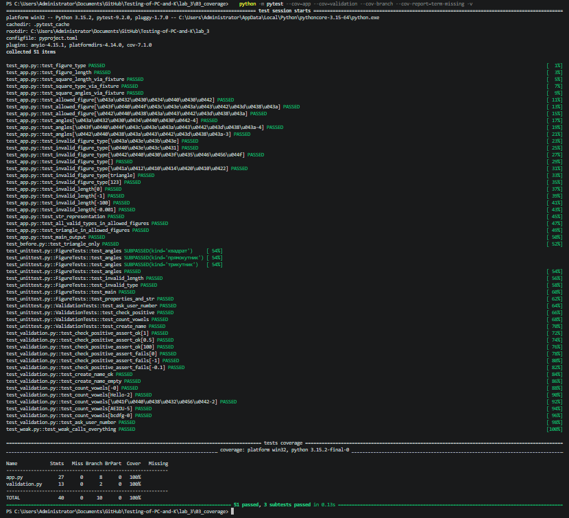

* **Завдання 5 — Налаштування `.coveragerc` та `pragma: no cover`**
    1. Створили файл `.coveragerc`, щоб не передавати параметри щоразу в командному рядку
    2. `source = .` — аналізується код у поточній папці, `branch = true` — вимірюються розгалуження, `omit` — тести та службові файли виключені зі звіту
    3. Перевірили, що `app.py` входить у звіт, а тестових файлів у ньому немає
    4. Точку входу `if __name__ == "__main__":` позначили `# pragma: no cover` і порівняли результат із конфігом без pragma

```ini
[run]
source = .
branch = true

[report]
omit =
    test_*.py
    */tests/*
    */__init__.py
    */.venv/*
    make_report.py
```

```python
if __name__ == "__main__":  # pragma: no cover
    main()
```

```text
python -m coverage erase
python -m coverage run "--rcfile=.coveragerc_nopragma" -m pytest test_app.py test_validation.py
python -m coverage report "--rcfile=.coveragerc_nopragma" -m
```

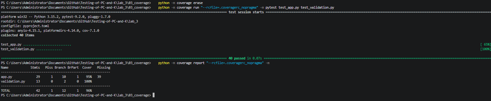

| Варіант | Stmts | Miss | Branch | BrPart | Cover | Missing |
|---|---|---|---|---|---|---|
| З `pragma: no cover` | 40 | 0 | 10 | 0 | 100% | — |
| Без `pragma: no cover` | 42 | 1 | 12 | 1 | 96% | app.py: 39 |

Чому використали `pragma: no cover`: блок `if __name__ == "__main__":` виконується лише при прямому запуску скрипта, а при імпорті з тестів умова завжди хибна, тому рядок 39 недосяжний для тестів. Це службовий код, а не тестована поведінка. Вся логіка (`Figure`, `get_angles`, `validation.py`, `main()`) покрита тестами, тому pragma не приховує нічого важливого. Використовувати його для штучного підвищення відсотка не можна.

* **Завдання 6 — HTML- та XML-звіти**
    1. Згенерували HTML-звіт і відкрили `htmlcov/index.html` у браузері
    2. Згенерували XML-звіт `coverage.xml`
    3. У HTML-звіті загальне покриття 100%, у стовпці `excluded` для `app.py` стоїть 2 — це точка входу, виключена через pragma

```text
python -m coverage html
python -m coverage xml
```

Створення звітів:

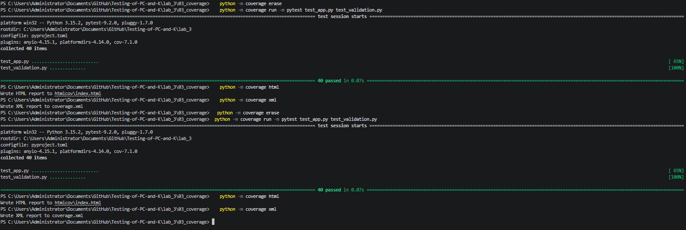

HTML-звіт у браузері:

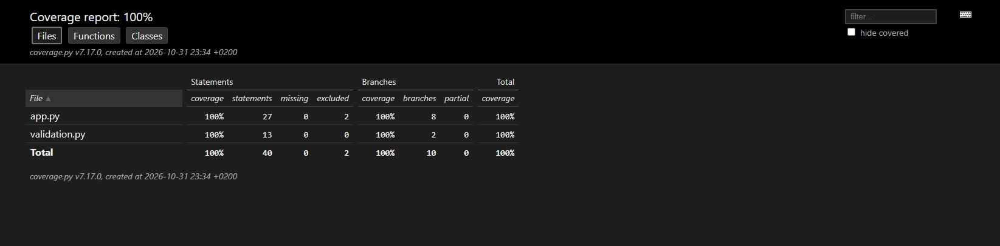

Призначення форматів:
- HTML — для людини: у браузері видно файли, відсотки та підсвічені рядки (покриті, непокриті, частково покриті гілки)
- XML — для інструментів: CI-системи та сервіси аналізу покриття (наприклад Codecov) читають його автоматично

* **Завдання 7 — Чого coverage не доводить**
    1. Написали тест `test_weak.py`, який викликає весь код, але не містить жодного `assert`
    2. Виміряли покриття — воно таке саме, як і в повного набору: 100% за рядками й гілками
    3. У `app.py` тимчасово змінили гілку квадрата `return 4` на `return 5` (помилка: 5 кутів)
    4. Запустили обидва набори: тест без `assert` пройшов, тести з `assert` виявили помилку
    5. Повернули `return 4`, після чого всі тести знову проходять

```python
def test_weak_calls_everything():
    for kind in ("квадрат", "прямокутник", "трикутник"):
        f = Figure(kind, 5)
        f.get_angles          # результат не перевіряється
        ...
    main()
    count_vowels("Привіт")    # результат не перевіряється
```

```text
python -m coverage erase
python -m coverage run -m pytest test_weak.py
python -m coverage report -m

python -m pytest test_weak.py
python -m pytest test_app.py
```

Покриття тесту без `assert`:

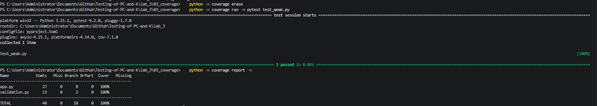

Зламаний код, тест без `assert` (пройшов):

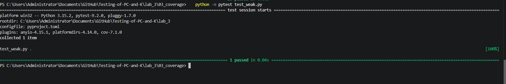

Зламаний код, тести з `assert` (впали):

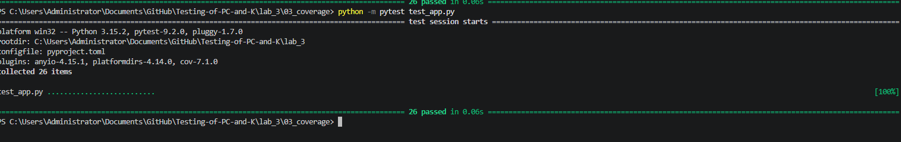

Чому 100% line coverage не означає відсутності помилок:
- покриття лише фіксує, що рядок виконувався, а не що результат правильний
- воно не знає про вхідні дані, яких тести не пробували
- воно не виявляє логіку, якої в коді немає взагалі

* **Завдання 8 — Поріг покриття та CI**
    1. Перевірили поріг 90% на повному наборі тестів — поріг досягнуто
    2. Перевірили той самий поріг на початковому наборі (`test_before.py`) — запуск завершився помилкою
    3. Налаштували GitHub Actions (`.github/workflows/coverage.yml`): тести, генерація `coverage.xml`, завантаження артефакту, невдача при покритті нижче 90%

```text
python -m pytest test_app.py test_validation.py --cov=app --cov=validation --cov-branch --cov-fail-under=90
python -m pytest test_before.py --cov=app --cov=validation --cov-branch --cov-fail-under=90
```

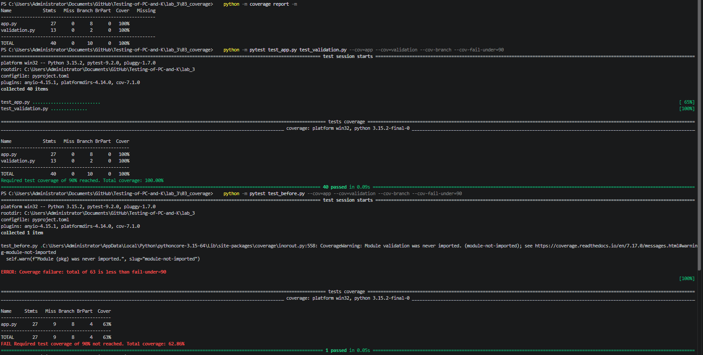

| Набір тестів | Покриття | Результат |
|---|---|---|
| test_app.py + test_validation.py | 100% | Required test coverage of 90% reached |
| test_before.py | 62,86% | FAIL Required test coverage of 90% not reached |

Примітка: `pytest-cov` не включає до звіту модуль, який жоден тест не імпортував (`validation.py`), тому для `test_before.py` показано лише `app.py` (63%), а не 44%, як при `coverage run` із `source = .`.

```yaml
- run: pip install coverage pytest pytest-cov
- run: pytest --cov=app --cov=validation --cov-branch --cov-report=xml --cov-report=term-missing --cov-fail-under=90
- uses: actions/upload-artifact@v4
  with:
    name: coverage-xml
    path: 03_coverage/coverage.xml
```

<!-- 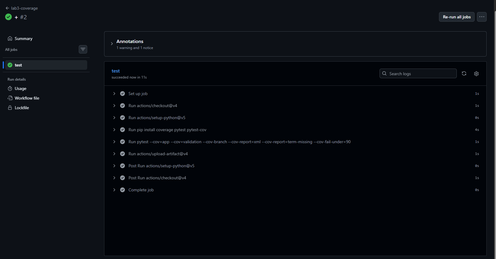 -->

* **Що не комітиться** (файл `.gitignore`):
```text
__pycache__/
.coverage
htmlcov/
.pytest_cache/
coverage.xml
```

* **Команди запуску:**
```text
cd lab_3\03_coverage
python -m pytest -v
python -m coverage erase
python -m coverage run -m pytest test_app.py test_validation.py
python -m coverage report -m
python -m coverage html
```

* **Результат виконання тестів:**


---
### Висновок:

- В роботі виміряно покриття коду тестами за допомогою `coverage.py` та `pytest-cov`
- Мету роботи досягнуто — покриття зросло з 44% до 100% як за рядками, так і за гілками
- Отримано знання про `coverage erase/run/report/html/xml`, `.coveragerc`, `pragma: no cover`, `--cov-branch`, `--cov-fail-under`
- Branch coverage строгіший за line coverage: він показує умови, у яких тести пройшли лише один напрямок (`BrPart`)
- Високий відсоток покриття не гарантує якості: тест без `assert` має таке саме покриття, але не виявляє помилку
- Складність виникла з налаштуванням середовища: `poetry` не був встановлений, тому всі команди виконували через `python -m`
- Формат здачі через GitHub зручний і наочний
